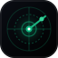

<div align="center">



# SubRadar Enterprise & Personal FinOps
### Kurumsal Yazılım Varlığı Denetimi, Hava Boşluklu (Air-Gap) Finansal Zekâ ve Yasal Fesih Otomasyonu

[](https://github.com/Laynexsw/SubRadar/tree/main/app)
[](https://github.com/Laynexsw/SubRadar/tree/main/app/src/main)
[](privacy.html)
[](terms.html)
[](https://laynexsw.github.io/SubRadar/#os-downloads)
[](licenses/README.md)

<br/>

**SubRadar**; finans direktörleri (CFO), bilgi güvenliği yöneticileri (CISO), BT satın alma departmanları ve bağımsız profesyoneller için geliştirilmiş **sıfır-güven (Zero-Trust) tabanlı masaüstü FinOps ve abonelik yönetişim platformudur**.  
Organizasyon genelindeki kayıt dışı yazılım aboneliklerini (**Gölge IT / Shadow IT**), atıl kullanıcı koltuklarını (**SaaS Sprawl**) ve iptal süreçlerini zorlaştıran manipülatif arayüzleri (**Dark Patterns**); finansal verilerinizi üçüncü taraf bulut sunucularına aktarmaksızın **%100 yerel donanım izolasyonu** altında tespit eder, denetler ve hukuki zeminde sonlandırır.

<br/>

[**🌐 Resmi Ürün Portalı ve Canlı Simülatör**](https://laynexsw.github.io/SubRadar/) &nbsp;&bull;&nbsp; [**💻 Masaüstü Çekirdeği (v1.5.0)**](app/README.md) &nbsp;&bull;&nbsp; [**📜 Kurumsal Lisans Matrisi**](licenses/README.md) &nbsp;&bull;&nbsp; [**🔒 Veri Gizliliği Taahhütnamesi**](privacy.html) &nbsp;&bull;&nbsp; [**⚖️ Hizmet Şartları**](terms.html)

</div>

---

## 📊 Kurumsal Değer Önerisi ve Finansal Geri Kazanım (Executive Summary & ROI)

Kurumsal yazılım ekosistemlerinde tekrarlayan lisans giderleri, donanım yatırımlarından sonraki en büyük operasyonel maliyet kalemini oluşturmaktadır. Bağımsız sektör denetimleri, orta ve büyük ölçekli işletmelerde **yıllık SaaS bütçesinin %24 ila %32'sinin** aktif kullanılmayan lisanslara, işten ayrılan personelin açık kalan hesaplarına ve otomatik yenilenen deneme paketlerine harcandığını ortaya koymaktadır.

### Geleneksel Çözümlerin Operasyonel ve Hukuki Açmazı
1. **Üçüncü Taraf Veri İhlali Riski (Plaid / Yodlee / Bulut Toplayıcıları):** Bulut tabanlı harcama takip yazılımları, kurumsal kredi kartı ekstrelerini ve açık bankacılık API anahtarlarını kendi uzak sunucularında işler. Bu mimari; KVKK, GDPR ve finansal regülasyonlar açısından yüksek **veri sızıntısı (Data Breach)** ve uyumluluk riski doğurur.
2. **Karanlık Desen (Dark Pattern) Kaynaklı İşgücü Kaybı:** Kurumsal SaaS sağlayıcıları, abonelik iptal akışlarını çok aşamalı onay ekranları ve müşteri temsilcisi engelleriyle ortalama **4,2 ila 18 dakikalık** bürokratik süreçlere dönüştürür.
3. **Abonelik Takibi İçin Tekrar Abonelik Satın Alma Çelişkisi:** Piyasadaki finansal yönetim araçları, maliyet düşürme vaadine rağmen aylık/yıllık yinelenen kira bedelleri talep ederek şirket bilançosuna yeni bir sabit gider ekler.

### SubRadar Kurumsal Standardı
SubRadar, **Hava Boşluklu (Air-Gapped) İstemci Mimarisi** ve **Tek Seferlik Ömür Boyu (Perpetual) Lisanslama** modeli ile finansal verilerin kurum sınırları dışına çıkmasını kriptografik olarak imkânsız kılar; ilk denetim döngüsünde lisans yatırım maliyetini (ROI) katbekat amorti eder.

---

## 🏛️ Çekirdek Ürün Yetkinlikleri ve Kurumsal Mimari Sütunlar

| Kurumsal Modül | Teknik Altyapı ve Kriptografik Standart | Kurumsal Operasyonel Kazanım |
| :--- | :--- | :--- |
| 🛡️ **Yerel Şifreli Kasa (Zero-Knowledge Vault)** | `AES-256-CBC` şifreleme + `scrypt` (N=16384, r=8, p=1) anahtar türetme + `HMAC-SHA256` bütünlük imzası. | Veritabanı (`encrypted_sqlite_aes256.subradar`) yalnızca yerel diskte şifreli bloklar halinde tutulur. Şifreleme anahtarı RAM dışına çıkmaz; merkezi sunucu veya telemetri bulunmaz. |
| ✈️ **Hava Boşluklu Ekstre Analizörü (Air-Gap Parser)** | %100 istemci taraflı deterministik ayrıştırıcı ve 18+ kurumsal SaaS imza kütüphanesi. | Banka ve kurumsal kredi kartı ekstreleri (CSV / metin) internet bağlantısı kesikken dahi yerel bellekte taranır; mükerrer lisanslar ve gizli fiyat artışları saniyeler içinde raporlanır. |
| ⚖️ **Doğrudan Fesih & Resmi İhtarname Motoru** | Doğrudan İptal Protokolü + **6502 SK** ve **GDPR Madde 17 (Unutulma Hakkı)** şablon derleyicisi. | Karanlık desen labirentlerini baypas ederek doğrudan servis sağlayıcının fesih uç noktasına yönlendirir ve hukuk müşavirliği standartlarında resmi cayma/fesih ihtarnamesi üretir. |
| 🖥️ **Executive Glassmorphism & Komut Ergonomisi** | Çerçevesiz Electron v33 masaüstü istemcisi, `⌘K` / `Ctrl+K` hızlı komut paleti ve WebGL 2.0 donanım ivmesi. | Finans ve BT ekiplerinin klavyeden elini kaldırmadan saniyeler içinde lisans denetimi, döviz kuru dönüşümü (`USD`/`EUR`/`TRY`) ve risk radarı analizi yapmasını sağlar. |

---

## 📁 Kurumsal Proje Mimarisi ve Eksiksiz Dosya Kataloğu

Proje yapısı; güvenlik politikaları, kurumsal lisans çerçevesi, masaüstü işletim çekirdeği, Originkit görsel motorları ve modüler web platformu katmanlarına ayrılmıştır. **Tüm dosyalar tam ve eksiksiz olarak listelenmiştir:**

```text
SubRadar/
│
├── 🏛️ 1. KÖK YÖNETİM, GÜVENLİK VE METADATA KATMANI (ROOT GOVERNANCE & POLICIES)
│   ├── index.html                        # Kök yönlendirici (Canlı GitHub Pages trafiğini anında web/code.html'e aktarır)
│   ├── 404.html                          # Özel Apple Glass 404 hata sayfası (animasyonlu radar tarayıcı & hızlı aksiyonlar)
│   ├── privacy.html                      # %100 Sıfır Bilgi & Çevrimdışı Gizlilik Politikası (GDPR Madde 17 / KVKK uyumlu)
│   ├── terms.html                        # Kullanım Koşulları ve yerel sorumluluk sınırları dokümantasyonu
│   ├── thanks.html                       # Kurumsal başvuru onay ve teşekkür sayfası (takip kodlu #SR-2026-X91)
│   ├── robots.txt                        # Arama motoru indeksleme politikaları ve sitemap direktifi
│   ├── sitemap.xml                       # Çok dilli (TR/EN/DE) küresel SEO site haritası
│   ├── favicon.svg                       # Yüksek kontrastlı neon zümrüt radar favicon vektörü
│   ├── og-image.svg                      # 1200x630 Kurumsal sosyal medya (Open Graph & Twitter Card) önizleme görseli
│   ├── .nojekyll                         # GitHub Pages Jekyll statik derleyici devre dışı bırakma bayrağı
│   ├── .gitignore                        # Versiyon kontrolünden hariç tutulan sistem ve geçici dosyalar
│   ├── LICENSE                           # Proje ana MIT Açık Kaynak Lisansı
│   ├── PRODUCT.md                        # Ürün vizyonu, hedef kitle, erişilebilirlik (WCAG) ve marka ilkeleri
│   ├── tsconfig.json                     # TypeScript / React (Originkit TSX) derleyici ve tip kontrol yapılandırması
│   ├── README.md                         # [BU DOSYA] Kurumsal karşılama, mimari harita ve yönetim dokümantasyonu
│   ├── AGENTS.md                         # AI ajanları ve LLM oturumları için hızlı kurumsal bellek ve bağlam kılavuzu
│   ├── CODEBASE.md                       # Eksiksiz kod tabanı, fonksiyon imzaları ve DOM ID kataloğu
│   └── .agents/                          # Otonom AI Mühendislik Organizasyonu, Kurallar ve Yetenekler
│       ├── rules/codebase-context.md     # Geliştirme kuralları, Baş Orkestratör yetkilendirme ve hafıza politikaları
│       ├── agents/                       # 5 Departman / 21 Kalıcı Uzman Alt Ajan (Subagent) tanım dosyaları (*/agent.md)
│       └── skills/                       # 14 Yerel Skill Paketi (impeccable, ui-ux-pro-max, design-system, ui-styling, brand, banner-design, design, slides, ponytail, ponytail-review, ponytail-audit, ponytail-debt, ponytail-gain, ponytail-help)
│
├── 📜 2. KURUMSAL LİSANS ŞABLON KOLEKSİYONU & MATRİSİ (LICENSES FRAMEWORK - licenses/)
│   ├── README.md                         # Lisans karşılaştırma matrisi, ticari haklar ve kurumsal seçim rehberi
│   ├── MIT.txt                           # Varsayılan izin verici (Permissive) açık kaynak lisansı
│   ├── APACHE-2.0.txt                    # Patent koruması içeren kurumsal izin verici lisans
│   ├── BSD-3-CLAUSE.txt                  # Reklam ve isim kullanım kısıtlamalı izin verici lisans
│   ├── BSD-2-CLAUSE.txt                  # Sadeleştirilmiş 2 maddeli FreeBSD açık kaynak lisansı
│   ├── GPL-3.0.txt                       # Güçlü copyleft genel kamu lisansı
│   ├── AGPL-3.0.txt                      # Bulut ve SaaS dağıtımları için ağ düzeyinde güçlü copyleft lisansı
│   ├── MPL-2.0.txt                       # Dosya tabanlı zayıf copyleft kurumsal hibrit lisansı
│   ├── UNLICENSE.txt                     # Kamu malı (Public Domain) sıfır-kısıtlama feragatnamesi
│   └── PROPRIETARY.txt                   # Kapalı kaynak ticari lisans sözleşmesi metni
│
├── 💻 3. MASAÜSTÜ İŞLETİM SİSTEMİ ÇEKİRDEĞİ (DESKTOP RUNTIME CORE - app/ v1.5.0)
│   ├── package.json                      # Desktop bağımlılıkları ve çalıştırma scriptleri (start, dev, test, test:vault, test:parser)
│   ├── main.js                           # Electron ana süreci (çerçevesiz Apple Glass pencere, güvenli IPC denetleyicisi)
│   ├── preload.js                        # contextIsolation güvenli IPC köprüsü (Renderer -> Node.js subradarAPI)
│   ├── README.md                         # Masaüstü uygulaması teknik mimari, test ve çalıştırma el kitabı
│   │
│   ├── src/main/                         # Node.js Çekirdek & Kriptografik Güvenlik Katmanı
│   │   ├── vault.js                      # AES-256-CBC + scrypt + HMAC-SHA256 yerel kasa kripto motoru
│   │   ├── vault.test.js                 # Sıfır-bağımlılık kriptografik doğrulama ve bozulma birim testleri
│   │   ├── store.js                      # Şifreli yerel disk deposu yöneticisi (encrypted_sqlite_aes256.subradar)
│   │   ├── legal-notice.js               # 6502 SK & GDPR Madde 17 resmi cayma/fesih bildirim derleyicisi
│   │   ├── statement-parser.js           # 100% Çevrimdışı banka ekstresi & CSV tarayıcısı (18+ kurumsal SaaS kalıbı)
│   │   └── parser.test.js                # Ekstre ayrıştırıcı ve yasal bildirim derleyici birim testleri
│   │
│   └── src/renderer/                     # Apple Glassmorphism Masaüstü Arayüzü (SF Pro & Inter)
│       ├── .gitkeep                      # Dizin bütünlük koruyucusu
│       ├── index.html                    # Çerçevesiz ana masaüstü penceresi, 6 modül görünümü, ⌘K paleti & kasa kilit kapısı
│       ├── styles/                       # Masaüstü Stil Katmanı
│       │   ├── .gitkeep                  # Dizin koruyucu
│       │   ├── app.css                   # Çerçevesiz pencere gövdesi, trafik ışıkları, drag-region ve ızgara düzeni
│       │   └── components.css            # Cam kartlar, durum rozetleri, modallar ve kaydırıcı bileşenleri
│       └── scripts/                      # Masaüstü Arayüz Mantığı & Kütüphaneleri
│           ├── .gitkeep                  # Dizin koruyucu
│           ├── app.js                    # Masaüstü durum yönetimi, modül geçişleri, arama ve IPC dinleyicileri
│           ├── presets.js                # 16+ kurumsal SaaS ve tüketici abonelik ön ayar veritabanı
│           ├── crypto-fallback.js        # WebCrypto ve Node.js crypto arasındaki güvenli yedek köprü
│           └── three.min.js              # Masaüstü donanım ivmeli 3D arka plan efekt motoru
│
├── 🧩 4. ORIGINKIT & HARİCİ UI BİLEŞENLERİ (DESIGN SYSTEM RIG - components/)
│   └── originkit/
│       └── ui/
│           ├── tiles-loader.tsx          # Originkit CLI resmi React/TypeScript Tiles Loader bileşeni
│           └── vector-wordmark.tsx       # Originkit CLI resmi React/TypeScript Vector Wordmark bileşeni (WebGL 2.0)
│
└── 🌐 5. WEB TANITIM VİTRİNİ, SİMÜLATÖR & PWA PLATFORMU (WEB PLATFORM - web/)
    ├── code.html                         # GitHub Pages'ın sunduğu tekil monolitik üretim paketi (Tüm bileşenler, CSS ve JS dahil)
    ├── index.html                        # web/ içi hızlı kök yönlendirici -> code.html
    ├── 404.html                          # Web alt dizin 404 hata sayfası
    ├── privacy.html                      # Web alt dizin gizlilik politikası sayfası
    ├── terms.html                        # Web alt dizin kullanım koşulları sayfası
    ├── thanks.html                       # Web alt dizin başvuru teşekkür ve takip kodu sayfası
    ├── test-tiles.html                   # Originkit Tiles Loader bağımsız görsel test ve demo laboratuvarı
    ├── favicon.svg                       # Web vitrini favicon vektörü
    ├── og-image.svg                      # Web vitrini 1200x630 Open Graph sosyal medya kartı
    ├── manifest.json                     # Progressive Web App (PWA) manifesti (çevrimdışı ve tam ekran desteği)
    ├── sw.js                             # Çevrimdışı Service Worker önbellekleme motoru (v1.6.1 Network-First HTML)
    │
    ├── assets/                           # Web Varlık ve Medya Klasörü
    │   └── cursors/                      # Windows 11 Tailless Cursors (Jepri Creations) 32x32 RGBA imleç varlıkları (Dark / Light)
    │
    ├── vendor/                           # Yerel Üçüncü Parti Çevrimdışı Kütüphaneler
    │   └── three/                        # Donanım ivmeli 3D WebGL motoru (three.min.js, three.module.js)
    │
    ├── components/                       # 23 Parçalı Modüler HTML UI Bileşenleri
    │   ├── layout/                       # Çerçeve & Genel Düzen Bileşenleri
    │   │   ├── header.html               # Üst cam çubuk, logo, ⌘K, ses, kısayol, dil, kur ve tema kontrolleri
    │   │   ├── footer.html               # Alt bilgi, Originkit Vector Wordmark, canlı yerel gecikme ve telif bildirimleri
    │   │   ├── cookie-banner.html        # Minimal Apple Glass çerez kartı ve canlı kullanıcı telemetri onayı
    │   │   ├── mobile-sticky-cta.html    # Mobilde altta sabit kalan hızlı indirme ve aksiyon çubuğu
    │   │   └── tiles-loader.html         # Originkit Tiles Loader editoryal karo yükleme ve yüzde sayacı iskeleti
    │   │
    │   ├── sections/                     # Sayfa Bölümleri & İşlevsel Modüller
    │   │   ├── hero.html                 # Hero vitrin alanı, çift kurumsal CTA ve interaktif macOS pencere simülasyonu
    │   │   ├── problem.html              # Kurumsal abonelik israfı, sektör metrikleri ve karanlık desen teşhiri
    │   │   ├── statement-lab.html        # Canlı hava boşluğu (Air-Gap) banka ekstresi ve kaçak lisans tarayıcısı
    │   │   ├── calculator.html           # FinOps israf hesaplayıcı, kaydırıcılar, PNG röntgen ihracı ve X paylaşımı
    │   │   ├── comparison.html           # Şeffaflık & güven rakip karşılaştırma matrisi (SubRadar vs Bulut Takipçileri)
    │   │   ├── features.html             # Çekirdek 4 motor özelliği: Audit, Auto-Intercept, Bypass, Vault
    │   │   ├── architecture.html         # Yerel AES-256 SQLite şifreleme ve zero-trust mimari diyagramı
    │   │   ├── os-downloads.html         # macOS, Windows ve Linux platform indirme kartları ve sürüm bilgileri
    │   │   ├── hash-verifier.html        # İstemci tarafı WebCrypto donanım ivmeli SHA-256 kurulum doğrulayıcı
    │   │   ├── pricing.html              # Free, Pro ($79) ve Enterprise tek seferlik ömür boyu fiyatlandırma tablosu
    │   │   └── faq.html                  # Sıkça sorulan sorular (SSS) akordeon bilgi paneli
    │   │
    │   ├── modals/                       # Etkileşimli Modallar & Kullanıcı Akışları
    │   │   ├── download-modal.html       # Mimari seçimi (ARM/x86), indirme ilerleme çubuğu ve rehber modalı
    │   │   ├── command-palette.html      # ⌘K / Ctrl+K Linear stili hızlı komut paleti arama penceresi
    │   │   ├── enterprise-modal.html     # Kurumsal çoklu koltuk teklif formu (inline doğrulama & spinner)
    │   │   ├── reclaim-modal.html        # Finansal geri kazanım adımları ve CLI kurulum panosu (`curl -sSL...`)
    │   │   ├── shortcuts-modal.html      # Raycast stili Power-User klavye kısayolları modalı (`?`, `T`, `S`, `C`, `L`, `D`)
    │   │   ├── legal-generator-modal.html# Canlı 6502 SK & GDPR Madde 17 resmi cayma ve fesih ihtarnamesi sihirbazı
    │   │   └── auth-modal.html           # İkili kayan panelli (Double-Slider Sliding Overlay) Apple Glass Monokrom modalı
    │   │
    │   └── originkit/                    # Modüler Originkit Tip ve React Uyumluluk Parçaları
    │       ├── react-shim.d.ts           # Saf JS ortamı için React TypeScript tip deklarasyon köprüsü
    │       └── tiles-loader.tsx          # Modüler paket içi Originkit Tiles Loader kaynak bileşeni
    │
    ├── css/                              # Web Stil Sistemi (Apple Glassmorphism)
    │   ├── base.css                      # Renk token'ları, SF Pro/Inter tipografi hiyerarşisi, açık/koyu tema sınıfları
    │   ├── components.css                # Cam efektleri, range slider, imleç ışığı, ses dalgası ve modal animasyonları
    │   ├── cursors.css                   # Windows 11 Tailless imleç CSS motoru ve Base64 veri URI kuralları
    │   └── main.css                      # Tüm CSS modüllerini derleyen ana stil orkestrasyonu
    │
    ├── js/                               # Web İstemci Zekâsı & Modüler Betikler
    │   ├── config.js                     # Sabitler, kurlar (USD, EUR, TRY) ve para birimi yöneticisi
    │   ├── supabase.js                   # Supabase v2 JS SDK istemcisi, Auth ve Bulut Veritabanı entegrasyon köprüsü
    │   ├── i18n.js                       # Kapsamlı TR/EN/DE çok dilli sözlüğü ve DOM metin düğümü çeviricisi
    │   ├── theme.js                      # Koyu / Açık tema geçiş yöneticisi (`html.light`, `html.dark`)
    │   ├── fx.js                         # Canlı döviz kurları çekici (open.er-api / frankfurter, 12 saat TTL)
    │   ├── toast.js                      # Apple Glass kayan bildirim balonu sistemi (`srShowToast`)
    │   ├── audio-fx.js                   # Web Audio API sıfır-dosya matematiksel osilatör dokunsal ses motoru (`srAudio`)
    │   ├── cursor-glow.js                # Dinamik imleç takipçi cam aydınlatma ve ışıma motoru
    │   ├── statement-lab.js              # İstemci taraflı hava boşluklu ekstre analizörü ve kaçak abonelik dedektörü
    │   ├── hash-verifier.js              # WebCrypto API donanım ivmeli SHA-256 kurulum doğrulama motoru
    │   ├── social-export.js              # HTML5 Canvas 1200x630 "Abonelik Röntgeni" PNG kart ihracı ve X paylaşımı
    │   ├── calculator.js                 # FinOps israf hesaplama algoritması ($32/araç + $78/deneme) ve profil geçişleri
    │   ├── hero-window.js                # macOS pencere simülasyonu: trafik ışıkları, canlı iptal, arama, sayaçlar
    │   ├── tiles-loader.js               # Originkit "Tiles Loader" saf JS motoru (hücre ızgarası, edRand, % sayacı)
    │   ├── vector-wordmark.js            # Originkit "Vector Wordmark" WebGL 2.0 motoru (2 kanallı atlas, 3 düğümlü kafes)
    │   ├── scroll-motion.js              # İlerleme çizgisi (`#sr-progress`), alt gezinme adası (`#sr-scrollspy`), reveal animasyonları
    │   ├── analytics.js                  # Canlı saniye sayacı, etkileşim telemetrisi ve kullanıcı izleme motoru (`srAnalytics`)
    │   ├── cookie-banner.js              # Minimal Apple Glass çerez kartı, otomatik açılış ve onay kontrolcüsü
    │   ├── mobile-cta.js                 # Mobilde kaydırmaya bağlı beliren dinamik hızlı aksiyon çubuğu
    │   ├── main.js                       # Tüm web modüllerini ve Service Worker'ı başlatan ana giriş dosyası
    │   │
    │   └── modals/                       # Etkileşimli Modal Kontrolcüleri
    │       ├── download-modal.js         # İndirme simülasyonu, hız/boyut sayacı, SHA doğrulaması ve dosya indirici
    │       ├── command-palette.js        # ⌘K klavye kısayolu, gerçek zamanlı filtreleme ve aksiyon tetikleyicisi
    │       ├── enterprise-modal.js       # Kurumsal form alanları doğrulayıcısı (inline hata denetimi & spinner)
    │       ├── reclaim-modal.js          # CLI komut kopyalama panosu (`curl -sSL...`) ve geri kazanım adımları
    │       ├── shortcuts-modal.js        # Power-User klavye kısayol dinleyicisi (`?`, `T`, `S`, `C`, `L`, `D`, `ESC`)
    │       ├── legal-gen.js              # Canlı yasal fesih metni derleyici, pano kopyalama ve `.txt` indirme yöneticisi
    │       └── auth-modal.js             # İkili kayan panel animasyonu (sliding overlay), sosyal giriş ve profil yöneticisi
    │
    └── scripts/                          # CI/CD & Derleme Otomasyon Betikleri
        ├── build.py                      # 23 modüler HTML bileşenini test eden ve doğrulayan Python betiği
        └── embed_tiles_loader.py         # Originkit Tiles Loader bileşenini code.html içine derleyip enjekte eden betik
```

---

## ⚖️ Kurumsal Karşılaştırma Matrisi: SubRadar vs. Geleneksel Bulut SaaS Araçları

| Değerlendirme Kriteri | SubRadar Enterprise & Personal FinOps | Bulut Tabanlı Harcama Takipçileri (Plaid / SaaS) | Manuel Tablolama (Excel / Sheets) |
| :--- | :--- | :--- | :--- |
| **Banka / API Erişim Yetkisi** | ❌ **Talep Edilmez** (%100 İzole) | ⚠️ **Zorunlu** (Açık bankacılık / şifre paylaşımı) | ❌ Talep edilmez |
| **Veri Barındırma & Egemenlik** | 🔒 **Yalnızca Kurum İçi Yerel Disk** | ☁️ **Üçüncü Taraf Bulut Sunucuları** | ☁️ Bulut / Yerel karışık |
| **Kriptografik Koruma** | 🛡️ **AES-256-CBC + scrypt + HMAC-SHA256** | 🔑 Sağlayıcı kontrolündeki paylaşımlı anahtarlar | ❌ Şifresiz düz metin (Plaintext) |
| **Otomatik Ekstre Ayrıştırma** | ⚡ **Yerel Bellek İçi Air-Gap Tarayıcı** | ☁️ Uzak sunucu üzerinde ayrıştırma | ❌ Tamamen manuel veri girişi |
| **Yasal Fesih & İptal Otomasyonu** | ⚖️ **Tek Tıkla Portal Baypası + Resmi İhtarname** | ❌ Yalnızca pasif bildirim veya komisyonlu aracılık | ❌ Yok |
| **Çevrimdışı (Air-Gap) Operasyon** | 🟢 **%100 Çevrimdışı Çalışır** | 🔴 Sürekli internet bağlantısı zorunludur | 🟡 Kısmi |
| **Finansal Maliyet Modeli** | ♾️ **Tek Seferlik Ömür Boyu (Perpetual) Lisans** | 💸 **Sürekli Aylık / Yıllık Abonelik Kesintisi** | 💸 Office / Workspace abonelik maliyeti |
| **KVKK & GDPR Madde 17 Uyumu** | 🇪🇺 **Tasarımdan İtibaren Tam Uyumlu (Privacy by Design)** | ⚠️ Veri işleyen sözleşmesi (DPA) ve sınır ötesi aktarım riski | ⚠️ Erişim kontrolü eksikliği |

---

## 🔒 Bilgi Güvenliği, Kriptografik Mimari ve Regülasyon Uyumluluğu (CISO Özeti)

SubRadar, finans ve savunma standartlarındaki bilgi güvenliği gereksinimlerini karşılamak üzere **Sıfır-Güven (Zero-Trust)** prensibiyle tasarlanmıştır:

1. **Sıfır Bilgi Mimarisi (Zero-Knowledge Architecture):** Uygulama hiçbir harici analitik, telemetri veya bulut senkronizasyon servisine veri iletmez. Kaydedilen lisans envanteri ve finansal tutarlar yalnızca kullanıcının belirlediği parola ile yerel cihazda çözülür.
2. **Endüstriyel Kriptografi (`app/src/main/vault.js`):** Kullanıcı parolası, kaba kuvvet (brute-force) ve ASIC donanım saldırılarına dayanıklı `scrypt` (CPU/Memory-hard KDF) fonksiyonundan geçirilerek 32 baytlık şifreleme anahtarı ve 32 baytlık doğrulama anahtarı üretir. Her kayıt işlemi benzersiz 16 baytlık başlatma vektörü (`IV`) ve zamanlama saldırılarına korumalı (`crypto.timingSafeEqual`) `HMAC-SHA256` bütünlük imzası ile mühürlenir.
3. **Süreç İzolasyonu (Electron Context Isolation):** Masaüstü çalışma zamanında `contextIsolation: true` ve `nodeIntegration: false` politikaları zorunludur. Görsel katman (Renderer), işletim sistemi çekirdeğine yalnızca `preload.js` üzerindeki denetlenmiş `subradarAPI` arayüzü ile erişebilir.
4. **Kurulum Paketi Bütünlük Doğrulaması (SHA-256):** Dağıtılan tüm kurulum imajları, istemci taraflı donanım ivmeli WebCrypto motoru (`hash-verifier.js`) üzerinden SHA-256 kriptografik özet kontrolüne tabidir.

---

## 💼 Ticari Paketler, Lisanslama ve Kurumsal Tedarik (Commercial Editions)

SubRadar; bireysel uzmanlardan çok uluslu kurumsal yapılara kadar farklı ölçeklerdeki organizasyonlar için şeffaf, öngörülebilir ve **sürekli kira dayatmayan** bir ticari model sunar:

| Paket / Lisans Tipi | Hedef Kitle ve Kapsam | Dağıtım ve Kurulum | Destek, Güncelleme ve SLA | Ticari Model |
| :--- | :--- | :--- | :--- | :--- |
| **Community Edition** | Bireysel geliştiriciler, açık kaynak denetçileri ve temel abonelik takibi. | Kaynak koddan yerel derleme / GitHub | Topluluk Desteği & Standart Sürümler | **Ücretsiz** ([MIT Lisansı](LICENSE)) |
| **Pro Perpetual** | Bağımsız danışmanlar, profesyonel kullanıcılar ve küçük/orta ölçekli ekipler. Sınırsız lisans kaydı, Air-Gap ekstre tarama ve 6502 SK / GDPR fesih sihirbazı. | İmzalı macOS (`.dmg`), Windows (`.exe` / `.msi`), Linux (`.AppImage` / `.deb`) | **Ömür Boyu (v1.x–v2.x) Güncelleme** & E-posta Desteği | **$79** *(Tek Seferlik Ödeme)* |
| **Enterprise Volume & SLA** | Kurumsal şirketler, finans/hukuk departmanları ve yüksek güvenlikli kurumlar. Çoklu koltuk yönetimi, özel SaaS regex tanımları ve şirket içi kapalı devre dağıtım. | Merkezi BT Dağıtımı (MDM, Jamf, Intune, Sessiz MSI/PKG) | **7/24 Öncelikli Kurumsal SLA**, Özel Entegrasyon & Fatura/Sözleşme | **Kurumsal Teklif** ([Başvuru Formu](https://laynexsw.github.io/SubRadar/)) |

> 📜 **Kurumsal Hukuk ve Satın Alma Departmanları İçin Not:** Kurumunuzun iç denetim ve tedarik politikalarına uygun olarak MIT, Apache 2.0, BSD-3, MPL 2.0 veya Kapalı Kaynak Ticari Lisans (**Proprietary Commercial License**) seçenekleri mevcuttur. Tam karşılaştırma tablosu ve resmi sözleşme metinleri için [**`licenses/README.md`**](licenses/README.md) kılavuzunu inceleyebilirsiniz.

---

## 🚀 Kurulum, Doğrulama ve Dağıtım Protokolü

### 1. Masaüstü İstemcisini Başlatma ve Kriptografik Birim Testleri (`app/ v1.5.0`)
Kurumsal masaüstü istemcisini yerel ortamda derlemek, kriptografik kasa bütünlük testlerini yürütmek ve uygulamayı başlatmak için:

```powershell
cd app
npm install

# AES-256-CBC kasa bütünlüğü ve Air-Gap ekstre ayrıştırıcı doğrulama testlerini çalıştırın
npm run test:vault
npm run test:parser

# Çerçevesiz masaüstü FinOps istemcisini başlatın
npm start
```

### 2. Web Platformu, Canlı Simülatör ve Bileşen Bütünlük Denetimi (`web/`)
Web tabanlı interaktif ürün simülatörünü ve Air-Gap ekstre laboratuvarını yerel ağda sunmak için:

```bash
# Yerel HTTP sunucusunu başlatın (Port: 8765)
python -m http.server 8765

# 23 modüler arayüz bileşeninin yapısal bütünlüğünü doğrulayın
python web/scripts/build.py
```
* **Yerel Erişim Noktası:** `http://localhost:8765/web/code.html` veya `http://localhost:8765/`
* **Canlı Küresel Yayın (Production):** [https://laynexsw.github.io/SubRadar/](https://laynexsw.github.io/SubRadar/)

---

## 📞 Kurumsal İletişim, Güvenlik Bildirimi ve Yasal Kaynaklar

* **Resmi Web Portalı & Canlı Demo:** [https://laynexsw.github.io/SubRadar/](https://laynexsw.github.io/SubRadar/)
* **Kurumsal Satın Alma & Çoklu Koltuk Teklifi:** `iletisim@subradar.dev`
* **Teknik Mimari ve Kod Kataloğu:** [`CODEBASE.md`](CODEBASE.md) & [`app/README.md`](app/README.md)
* **Yasal Politikalar:** [Gizlilik Politikası (`privacy.html`)](privacy.html) &bull; [Kullanım Koşulları (`terms.html`)](terms.html) &bull; [Lisans Koleksiyonu (`licenses/`)](licenses/README.md)

<div align="center">
<br/>
<sub><b>SubRadar Enterprise & Personal FinOps © 2026 Laynexsw. Tüm Hakları Saklıdır.</b><br/>Finansal veri egemenliği, kriptografik gizlilik ve sıfır-bilgi (Zero-Knowledge) standartlarıyla yerel olarak mühendislik edilmiştir.</sub>
</div>
